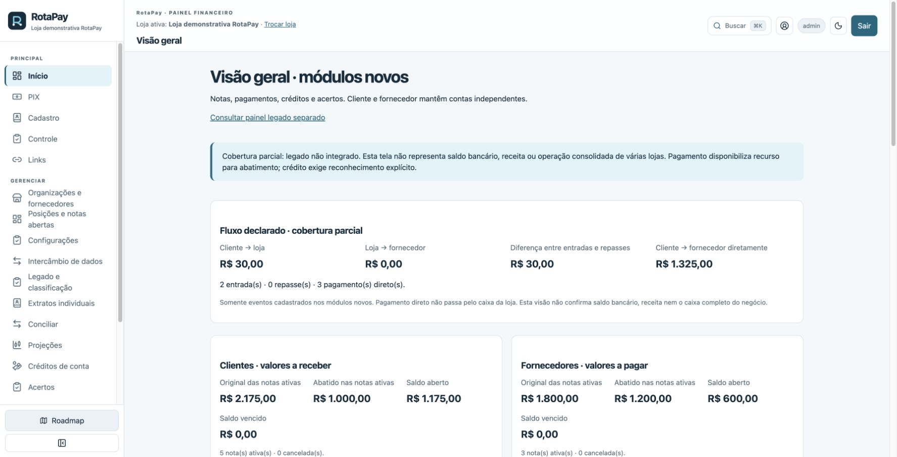
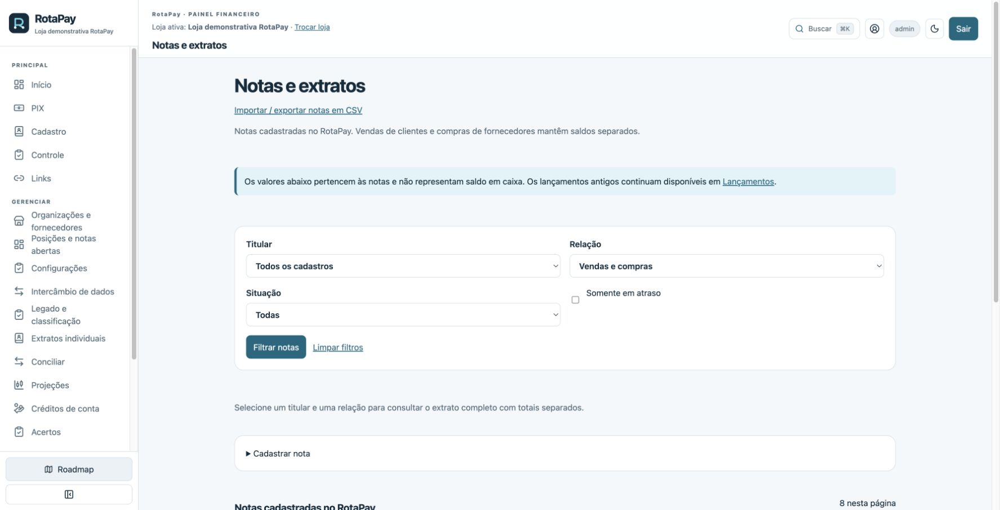

# RotaPay


**O RotaPay organiza as cobranças, os comprovantes e os pagamentos aos fornecedores.**

Uma plataforma para lojas que vendem com atendimento por vendedores, inclusive porta a porta, e precisam acompanhar cada cobrança até o acerto com seus fornecedores. A loja organiza o link PIX, o vendedor compartilha com a cliente e o histórico reúne os registros necessários para conferir e abater os pagamentos.

[Conheça o RotaPay](https://rotapay.site/) · [Aplicativo](https://app.rotapay.site/) · [Demonstração](https://demo.rotapay.site/login)

## Como funciona

1. **Loja:** organiza a cobrança e cria o link com valor fixo ou valor informado pela cliente.
2. **Vendedor:** compartilha o link durante o atendimento.
3. **Cliente:** acessa pelo celular, sem criar conta, e consulta as instruções e a situação da cobrança.
4. **Loja e fornecedor:** acompanham pagamentos registrados, comprovantes, abatimentos e acertos nas relações autorizadas.

O sistema registra os diferentes destinos do pagamento. Valores declarados e comprovantes anexados não equivalem a confirmação bancária automática. Essa integração ainda depende da Checkto.

## Funcionalidades do MVP

| Área | O que está disponível |
| --- | --- |
| Lojas e acessos | Ambientes por loja, permissões e fornecedores vinculáveis a várias lojas. |
| Cobranças | Links públicos de pagamento, valor fixo ou aberto e consulta de situação. |
| Cadastros | Clientes, fornecedores, contatos e chaves PIX. |
| Notas | Vendas e compras, vencimentos, situações, saldos e filtros. |
| Pagamentos | Registros, comprovantes privados e recursos disponíveis para abatimento. |
| Conciliação | Aplicação explícita de valores, histórico e reversões registradas. |
| Créditos e acertos | Reconhecimento explícito de créditos e acompanhamento dos acertos. |
| Extratos | Contas separadas por relação e compartilhamento somente para leitura com validade de 7 dias. |
| Operação | Importação/exportação, preferências de tabelas, consulta de posições e histórico. |
| Entrada de novas lojas | Formulário de qualificação para avaliação manual. |

**Regra central:** pagamento disponibiliza recurso para abatimento. Excedentes não viram crédito automaticamente. As contas de cliente e fornecedor permanecem independentes.

## Imagens do aplicativo

Capturas da demonstração em 04/10/2026. Todos os valores e participantes apresentados são demonstrativos.

### Visão geral



### Notas e extratos



## Estado atual e próximos passos

O MVP está disponível para testes. Produção e demonstração usam ambientes separados. O formulário público recolhe informações das lojas para avaliação; não cria automaticamente uma conta aprovada.

Pendências relevantes:

- Integração Checkto e confirmação bancária automática dos pagamentos.
- Verificação de e-mail e recuperação de senha.
- Validação operacional com as lojas e aprovação dos fluxos antes de ampliar o uso.

Os módulos de integração WhatsApp e caixa de entrada foram removidos. Anexos manuais e históricos permanecem disponíveis.

Para retomar desenvolvimento, consulte [o estado dos sprints](sprints/ESTADO-PROJETO.md). Esse documento registra entregas, relatórios, validações e pendências; deve ser atualizado a cada fechamento. Um novo sprint começa após confirmação do responsável pelo produto.

## Tecnologia

- **Backend:** Python, FastAPI, SQLAlchemy e SQLite; configuração por `DATABASE_URL`.
- **Frontend:** Next.js 16, React e TypeScript, com CSS próprio.
- **Página de vendas:** identidade RotaPay e animações GSAP.
- **Infraestrutura:** Docker Compose, VPS e Caddy com HTTPS.

A migração futura para Go está em discussão; não faz parte da stack atual.

## Desenvolvimento local

Use Python 3.14 e Node.js compatível com o Next.js do projeto. Configure segredos e URLs no ambiente local; não reutilize valores demonstrativos em produção.

```sh
python3 -m venv .venv
source .venv/bin/activate
pip install -r requirements.txt
cp .env.example .env
uvicorn app.main:app --reload --port 8000
```

Em outro terminal:

```sh
cd frontend
npm ci
# Configure API_URL=http://127.0.0.1:8000 em .env.local
npm run dev -- --port 3000
```

### Validação

```sh
PYTHONPATH=. python -m pytest tests/ -q
cd frontend
npm run lint
npx tsc --noEmit
npm run build
```

Bancos, uploads, backups, leads, senhas e configurações privadas ficam fora do Git. Credenciais da demo são fornecidas separadamente.

## Documentação

- [Continuidade e relatórios dos sprints](sprints/ESTADO-PROJETO.md)
- [Regras para desenvolvimento](AGENTS.md)
- [Design system](docs/design-system.md)
- [Guia de implantação na VPS](docs/deploy-vps.md)

Repositório privado do produto RotaPay. Não presume autorização de redistribuição.
