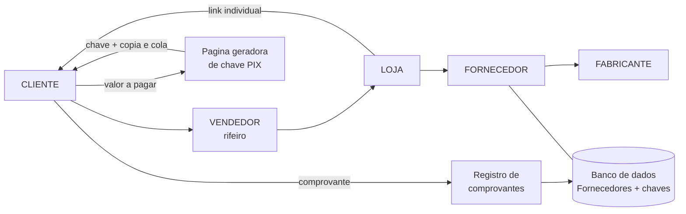

# Arquitetura — RotaPay (MVP)

Fonte: diagrama do Whimsical (cadeia + cadastros + página de pagamento) + PRD §§17–18.
Stack real: **Next.js 16 → FastAPI → SQLite** (migração Postgres via `DATABASE_URL`).

## 1. Cadeia (domínio)



Mapeamento no código: `CLIENTE`/`VENDEDOR` = `Pessoa(tipo=representante)`
com CPF; `FORNECEDOR`/`FABRICANTE`/`LOJA` = `Pessoa(tipo=fornecedor)` com
CNPJ, `prazo_dias` e chave PIX (`chave_pix`, `banco`, `conta`, `titular_chave`).
Papéis da cadeia são convenção sobre `tipo` — sem tabela nova no MVP.

## 2. Componentes

```mermaid
flowchart TB
    WEB[Next.js :3000\n(painel + /pagar pública)] --> API[FastAPI :8000\nregras RN-002..008]
    API --> DB[(SQLite pix.db)]
    API --> UP[uploads/ comprovantes]
    PG2[/pagar/:id pública/] -.sem auth.-> KEY[GET /chave-pix/:id]
```

## 3. Página de pagamento (`/pagar/:id`)

Equivale à "PÁGINA PARA GERAÇÃO DE CHAVE PIX" do diagrama: nome do
vendedor/fornecedor → campo do valor → botão → chave com copia-e-cola +
dados (nome, banco, conta). Pública (fora do middleware de auth).
Split/gateway dinâmico (Checkto/Mercado Pago) fica para a Release 2 —
hoje a página exibe a chave cadastrada, sem gerar cobrança.

## 4. Decisões (ADR resumido)

- Go→FastAPI, PG→SQLite migrável, Vite→Next.js: velocidade do MVP; contrato REST inalterado.
- Sem crédito automático no excedente (premissa do produto, `services.py`).
- `/chave-pix` pública por necessidade do fluxo; expõe só dados de pagamento.
- Comprovante ainda é `comprovante_path` na movimentação; entidade própria + OCR são Sprint 2–3.

## 5. Extensões pós-MVP (reunião 09/09/2026)

- **Perfil da loja**: tabela `loja` (linha única; `GET/PATCH /loja`). Exceção à regra "sem tabela nova" — é config, não domínio.
- **Prioridade**: `Pessoa.prioridade` (1 alta/2 normal/3 baixa, default 2) + override `Lancamento.prioridade` (null = herda). Base do rodízio.
- **Rodízio**: `GET /fila-pagamentos` — por fornecedor, nota aberta mais antiga (menor data, desempate id) + faltante + ordem (prioridade, data, faltante). Regra reconstruída da planilha; validar com o João.
- **Projeção automática**: `POST /projecoes/automaticas` (prevê sem `aplicar`, cria com `aplicar=true`, RN-006 respeitada, tudo auditado). Nunca concilia sozinho.
- **BR Code local**: `app/utils_brcode.py` — payload copia-e-cola sem banco; `GET /links/v/{token}` devolve `payload_pix` + `pago`.
- **Auditoria com IP**: middleware carimba `X-Forwarded-For`/remoto em contextvar; `AuditLog.ip`. Filtros `acao`/`usuario_id` em `GET /auditoria` + `GET /export/auditoria.csv`.
- **Filtros do Controle**: `chave` (remetente/destinatário/chave do fornecedor) + `com_link` em `GET /movimentacoes` e no CSV.
- **Triagem**: `GET /comprovantes/{cid}/arquivo` (ver) + `POST /comprovantes/{cid}/rejeitar` (sai da caixa, arquivo fica).
- **Migração leve**: `init_db()` cria tabelas + `ALTER TABLE ADD COLUMN` (ip, prioridades) sem perder dados.
